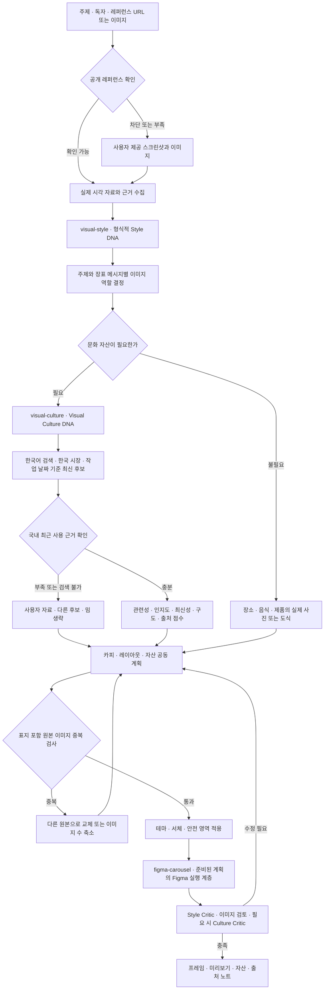
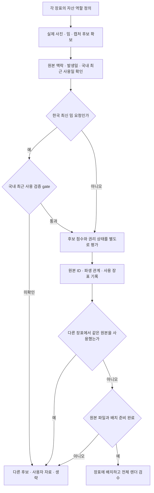

# design-carousel + Visual Culture DNA
한국어 캐러셀을 위한 세 가지 독립 Codex 스킬
기존 design-carousel의 모듈과 visual-style 자료를 보존하고 문화 분석을 추가했습니다. 이 ZIP은 설치용 패키지이며 자동 설치나 실제 캐러셀/Figma 제작을 수행하지 않습니다.

- `visual-style/`: 타이포·색·여백·레이아웃의 형식적 Style DNA.
- `visual-culture/`: 인물·밈·댓글·이모지·스티커·동물과 콜라주 문법, 문화 자산 선정과 출처.
- `design-carousel/`: 카피·자산·레이아웃 공동 기획과 평가를 묶는 지휘 계층.

각 폴더의 SKILL.md를 독립 호출할 수 있습니다. visual-style은 기존 design-skill의 자료를 정규화한 배포 사본이며 원본 설치 파일은 변경하지 않았습니다. design-carousel 통합 실행 시 세 폴더를 같은 skills 디렉터리에 두게 설정해두었습니다. `$figma-carousel`은 별도 설치 의존성이며 이 ZIP에 포함하지 않아요. 없어도 분석/계획 납품은 가능합니다.

## 제작 워크플로우

문화 요소가 불필요하면 `visual-culture`를 생략합니다. 사용자 이미지로 이어가는 경우에도 최신성 미확인을 그대로 기록하며, 실제로 하지 않은 검색이나 이미지 확인을 완료했다고 표현하지 않습니다. `$figma-carousel`은 기획과 소재 선정을 대신하지 않는 실행 계층이며 별도 스킬이 없으면 사용 가능한 Figma 도구와 필수 도구 스킬로 실행하거나, 연결이 불가능한 경우 계획 납품과 실제 제작 완료를 구분합니다.

## 현재 기본 제작 규칙

명시적인 사용자 지정이 우선. 
형식적 스타일 분석과 사용자 테마를 구별하고, 실제 브랜드 로고·사진의 고유 색상은 유지합니다.

| 항목 | 기본값 |
| --- | --- |
| 언어 · 캔버스 | 한국어 · 1080×1350 |
| 테마 컬러 | `#567D45` |
| 표지 | 흰색 글자 `#FFFFFF` 우선, 배경과 대비 확보 |
| 표지 외 장표 | 흰 배경 `#FFFFFF` · 검정 글자 `#000000` |
| 표지 대제목 | Pretendard ExtraBold 95 |
| 소제목 | Pretendard Bold 57 |
| 본문의 작은 텍스트 | Pretendard Regular 35 |
| 안전 영역 | 좌우 104px · 상하 120px, 편집 가이드 Y=120·1230 |
| 장수 표시 | `1/5`, `⅕장` 등 표시하지 않음 |
| 툴 · 브랜드 이름 | 확보한 실제 로고·워드마크 우선, 원본 비율 유지 |
| 검정 그라데이션 | 제공된 템플릿을 확인해 표지에 기본 적용 |

서체 숫자는 Figma `fontSize` 값입니다. 편집 가이드는 최종 이미지에 그리지 않아요. 배경·장식은 bleed가 가능하지만 주요 텍스트는 안전 영역에 둡니다. 흰 배경 본문 장표에 검정 그라데이션을 자동 적용하지 않고 필요한 사진 오버레이는 사진 영역에 한정합니다. 자세한 규칙은 [기본 제작 규칙](design-carousel/references/default-production-rules.md)에 있습니다.

### 한국 최신 밈·짤

한국어 콘텐츠는 **한국 시장 · 한국어 검색 · latest**를 기본으로 합니다. 최근 30일 국내 사용을 우선 확인하고, 부족하면 90일까지 확장합니다. 2026년 요청은 2026년 국내 사용 근거를 검증하며, 이후에도 실제 제작 날짜마다 조사합니다. 고정된 '2026 밈 목록'을 계속 재사용하지 않습니다.

가능한 한 독립적인 국내 최근 사용 2건으로 인지도와 유행을 뒷받침하도록 했습니다. 원본 발생일·최근 국내 사용일·조회 날짜를 구별합니다. 오래된 해외 밈도 국내 재유행 근거가 확인되면 검토할 수 있지만, 익숙하다는 이유로 한국 최신 짤을 대신하지 않습니다. 높은 점수로 국내 사용 근거 미확인을 덮지 않고 자료가 부족하면 사용자 이미지로 전환하거나 밈을 생략하고 한계를 한국어로 보고합니다. [한국 최신 밈 규칙](visual-culture/references/korean-current-memes.md)

### 장표 간 이미지 중복 방지

표지를 포함한 전체 캐러셀에서 동일 원본 이미지는 한 장표에만 배정합니다. 크롭·누끼·반전·색보정·리사이즈·콜라주 속 재사용도 중복. 
다른 URL이나 파일명이 같은 사진을 별개 자산으로 만들지 않고 같은 인물·브랜드의 실제로 다른 사진이나 화면은 사용할 수 있습니다.

원본 ID와 파생 관계·사용 장표를 기록하고 파일 해시와 전체 렌더로 검수하며 중복이 있으면 다른 원본을 찾거나 이미지 수를 줄입니다. 공통 로고·워터마크·공통 UI 아이콘은 반복 가능하며, 사용자에게 명시적으로 요청받은 반복은 그 지시를 따릅니다. [이미지 중복 방지 규칙](design-carousel/references/unique-slide-images.md)

## 한국어 사용 시나리오
### 1. Pinterest URL에서 시작
“$design-carousel 이 Pinterest 보드 [내 공개 보드 URL]를 참고해서 AI 툴 과몰입 주제로 6장 만들어줘. 한국 직장인이 알아보는 밈을 쓰고 싶어.”
Codex는 실제 공개 이미지를 먼저 확인하여 Style DNA와 Visual Culture DNA를 따로 추출합니다. 필요한 밈/반응 이미지를 한국어로 현재 웹에서 검색하고 국내 최근 사용 검증을 통과한 후보만 다섯 차원으로 평가합니다. 표지와 본문에는 서로 다른 원본을 배정합니다. 카피 길이·댓글 역할·크롭을 함께 계획하고 준비된 자산을 실행 계층에 전달합니다. 렌더에서 Style/Culture Critic이 수정합니다.

### 2. Instagram URL과 인물/댓글 콜라주
“$design-carousel 이 Instagram 게시물 [내 공개 게시물 URL]처럼 실제 인물을 뒤에 크게 놓고 댓글을 위에 얹어줘.”
URL이 막히면 이미 분석했다고 말하지 않고 대표 스크린샷으로 전환합니다. 사용자 자료에서 문화적 구성과 형식적 구성을 각각 분석하며 실제 작성자와 원본 댓글의 관계를 확인하고 댓글이 설명을 맡으면 본문을 줄입니다. 최신 사례가 필요할 때만 실제 검색 근거를 추가합니다.

### 3. 웹 도구가 없을 때
“$visual-culture 첨부한 세 장을 분석해줘.”
검색 상태를 unavailable 또는 not_attempted로 정확히 기록합니다. 업로드 이미지에서 근거를 뽑고 최신성은 미확인으로 둡니다. 실제 사진과 AI 장식·재구성 캡처를 별도 provenance로 표시합니다.

## 설치 및 검증
ZIP을 풀어 `design-carousel/`, `visual-style/`, `visual-culture/` 세 폴더를 `~/.agents/skills/` 아래에 나란히 복사합니다. 각 폴더 바로 안에 `SKILL.md`가 있어야 하며 패키지 부모 폴더 전체를 한 스킬로 넣지 않습니다. 폴더가 없으면 터미널에서 `mkdir -p ~/.agents/skills`로 만듭니다. 다음 입력에서 `$design-carousel`로 호출하고, 목록에 나타나지 않으면 Codex를 재시작합니다. 이 경로는 로컬 Codex용이며 GPT 등록을 자동으로 수행하지 않습니다. 기존 같은 이름 폴더가 있다면 먼저 비교/백업하고 필요한 변경만 반영합니다. 설치 폴더의 각 SKILL.md가 진입점이며 세 스킬은 서로 다른 곳에도 재사용할 수 있지만 design-carousel 통합 사용은 이름으로 찾거나 동일 skills 부모에 둡니다.
검증 도구는 Python jsonschema가 있는 환경에서 `python scripts/validate_package.py`로 실행합니다. 스키마·예시·자산 참조와 점수 상태를 확인하고 실제 웹 검색과 Figma 연결은 실행 환경에 따라 달라지며 이 패키지의 정적 검증이 그 성공을 보장하지 않습니다.

## 주제 우선 디렉팅으로 개선
댓글·밈·유명인·누끼는 필수 레시피가 아닙니다. 주제와 각 장의 메시지에서 이미지 역할을 먼저 결정하고 실제 후보를 본 뒤 처리와 구성을 선택합니다. 일반 이미지에는 문화적 인지도 점수를 강제하지 않습니다.
